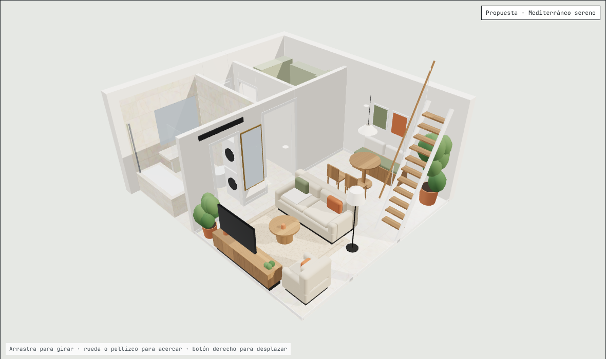
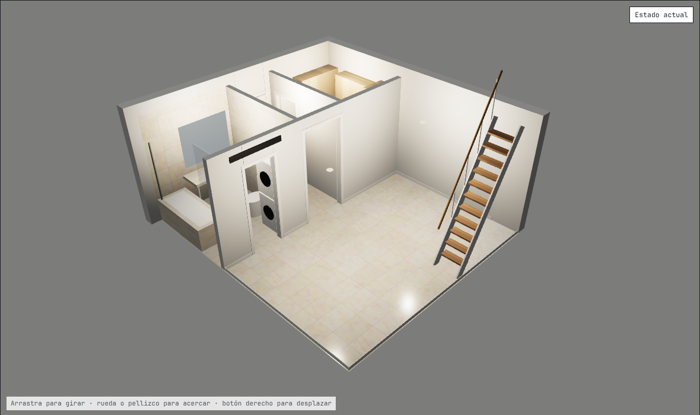
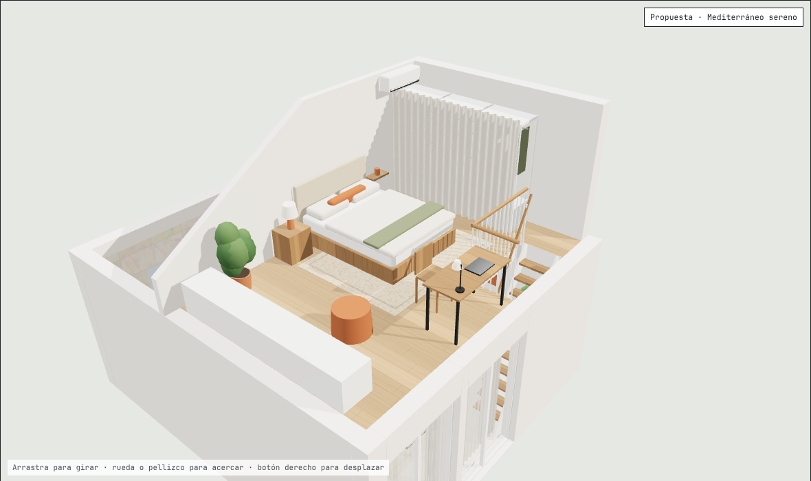
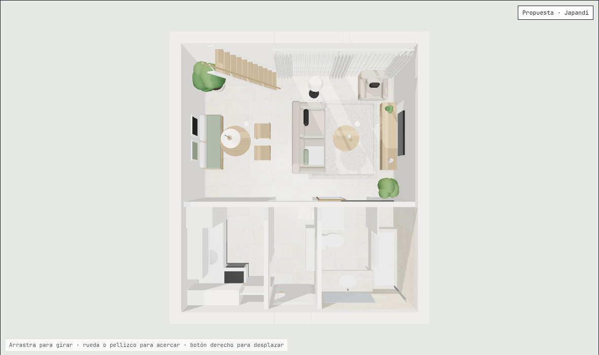
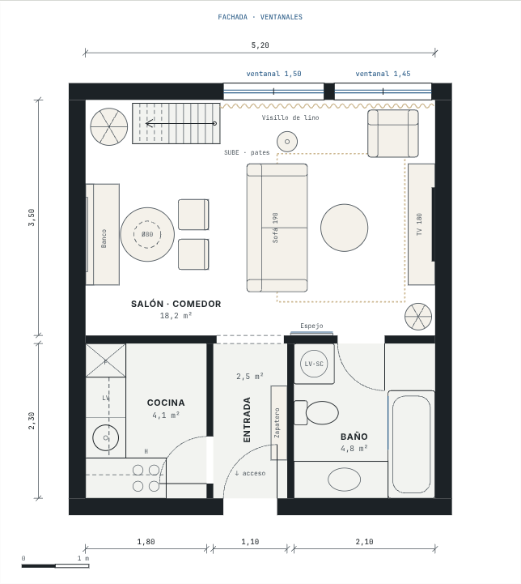
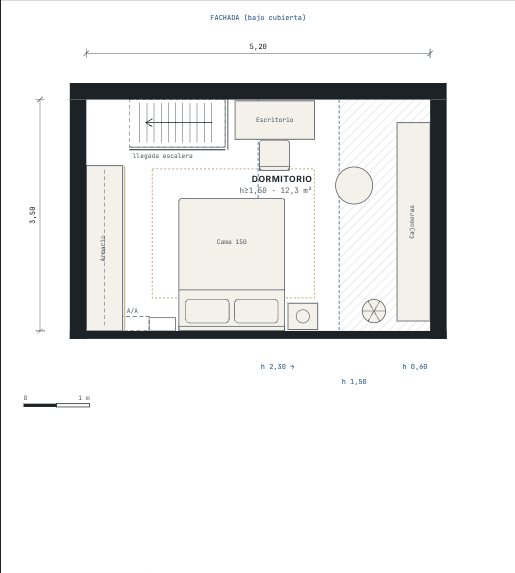

# Dúplex 40 m² · plano, maqueta 3D y propuesta de interiorismo

Levantamiento de un dúplex de unos 40 m² reconstruido a partir de 8 fotos y un vídeo. La planta baja tiene salón-comedor con dos ventanales, cocina independiente, baño y entrada. Arriba hay un altillo bajo cubierta, al que se sube por una escalera de pates.

Abre `index.html` en el navegador (necesita conexión para cargar three.js desde jsDelivr).

## Qué hay

| Archivo | Contenido |
|---|---|
| `src/app.html` | Fuente única: modelo paramétrico, planos SVG, maqueta 3D y memoria |
| `index.html` | Documento completo generado con `./build.sh` |
| `renders/*.png` | Vistas renderizadas de la maqueta (actual / propuesta, día / noche, estilos) |
| `renders/plano_*.svg` | Planos vectoriales exportados (planta baja y altillo) |

## Cómo está hecho

1. **Un solo modelo paramétrico** (`const P` en `src/app.html`). Todas las cotas están en metros y el origen es la esquina noroeste del salón. De ese modelo salen tanto los **planos 2D** (SVG generado) como la **maqueta 3D** (three.js). Si cambias una medida real, se actualizan los dos.
2. **Maqueta 3D** en three.js 0.160:
   - Iluminación física con tone mapping ACES y entorno PMREM para los reflejos del mármol.
   - Sombras suaves del sol, que solo entra por los ventanales.
   - Texturas procedurales hechas con canvas (mármol crema en baldosa de 60 × 40, roble, moqueta, azulejo), así que no hay que descargar imágenes.
   - Los muros que quedan entre la cámara y la casa se ocultan solos. Unos *proxies* invisibles siguen proyectando sombra, para que la luz no entre por donde no debe.
3. **Estados**: *Actual* (como en las fotos, con cortinas grises, moqueta y armarios abiertos) y *Propuesta*, en tres estilos: Mediterráneo sereno, Japandi y Clásico Madrid. También se puede elegir luz de día o de noche, solo la planta baja o con el altillo, y cinco cámaras, entre ellas las mismas vistas de las fotos.

## Supuestos

Las medidas son estimadas (± 15 cm) a partir de las baldosas (~60 × 40 cm), las puertas (72 cm) y la altura de techo (~2,55 m). Para afinar el modelo hay que medir:

- Ancho y fondo del salón
- Posición y ancho de los ventanales
- Anchos de cocina, pasillo y baño
- Altura máxima y mínima del altillo, y dónde empieza la pendiente
- Hueco de la escalera

Después, edita `P` en `src/app.html` y ejecuta `./build.sh`.

## Vistas

| | |
|---|---|
|  |  |
|  |  |
|  |  |
